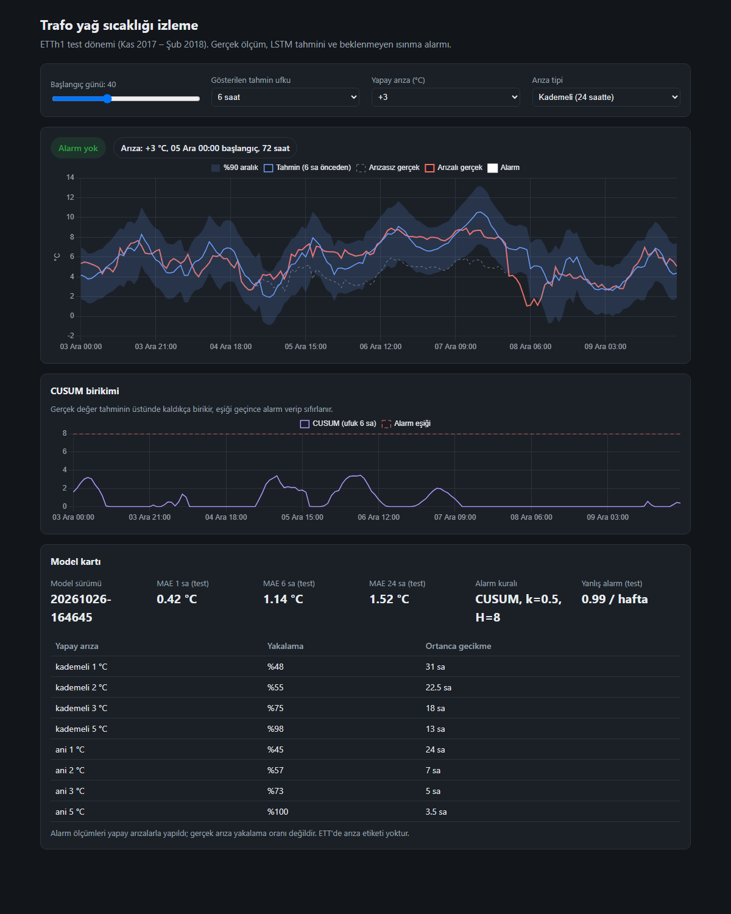
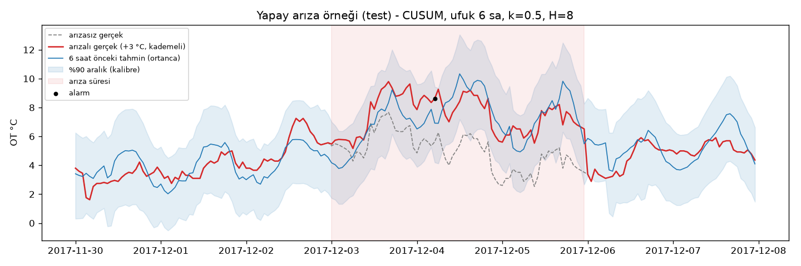

# Trafo yağ sıcaklığı: aralıklı tahmin ve beklenmeyen ısınma alarmı

Gerçek bir trafonun saatlik ölçümleriyle (ETTh1) yağ sıcaklığını 1, 6 ve 24 saat ileriye **aralıklı** tahmin eden bir LSTM; bu tahminden türetilen bir **beklenmeyen ısınma alarmı**; FastAPI + Docker ile sunulan servis ve izleme paneli.



## Özet

- **Nokta tahmininde LSTM, "son değer" çıtasını güvenilir biçimde geçmiyor.** 24 saat ufukta test MAE: LSTM 1,52 °C, son değer 1,53 °C. Ortam sıcaklığı verisi olmadan bu veri setinde beklenen bir sonuç.
- **Aralık tahmini kalibre edildi:** doğrulamada %90 hedefi tam tutturuldu, aralıklar %15 daraldı. Testte kapsama %95–97 (kış dönemi daha sakin; dağılım kayması).
- **Alarm (CUSUM), haftada ~1 yanlış alarmla 3 °C'lik kademeli ısınmanın %75'ini ortanca 18 saatte yakalıyor**; tek saatlik eşik kuralı aynı koşulda %20'de kalıyor. Ölçüm yapay arızalarla yapıldı (ETT'de arıza etiketi yok); gerçek arıza başarısı olarak sunulmaz.
- Proje boyunca kararlar ve gerekçeleri: [KARARLAR.md](KARARLAR.md)

## Veri ve problem

| | |
|---|---|
| Veri | [ETTh1](https://github.com/zhouhaoyi/ETDataset): 17.420 saat (Tem 2016 – Haz 2018), 6 yük ölçümü + yağ sıcaklığı (OT) |
| Bölme | Zamana göre 12 / 4 / 4 ay (ETT standardı). Rastgele bölme yok. |
| Girdi | Son 168 saat × (7 ölçüm + 4 saat/gün döngüsü özelliği) |
| Çıktı | Her ufuk (1, 6, 24 saat) için %5, %50, %95 yüzdelikleri |
| Hedef | Değişim: OT(t+h) − OT(t) |

**Dağılım kayması:** train ortalaması 17,1 °C, test (kış) 4,9 °C. Seviyeyi doğrudan öğrenen modeller testte çöküyor; bu yüzden hem hedef hem girdi şu anki sıcaklığa göre **göreli** tanımlandı (aşağıdaki tablolar).

## Sonuçlar

### Nokta tahmini (MAE, °C)

| Model | val 1 sa | val 6 sa | val 24 sa | test 1 sa | test 6 sa | test 24 sa |
|---|---|---|---|---|---|---|
| Son değer | 0,609 | 1,594 | 1,978 | **0,420** | **1,066** | 1,530 |
| Dünün aynı saati | 1,977 | 1,978 | 1,978 | 1,526 | 1,523 | 1,530 |
| Ridge, göreli özellik | 0,629 | 1,489 | 2,323 | 0,444 | 1,089 | 1,602 |
| Gradient boosting (quantile), mutlak özellik | 0,579 | 1,358 | 2,119 | 0,507 | 1,710 | 3,392 |
| Gradient boosting (quantile), göreli özellik | **0,571** | **1,283** | 2,183 | 0,423 | 1,099 | 1,675 |
| **LSTM 2×32 (seçilen)** | 0,595 | 1,353 | **1,972** | 0,425 | 1,142 | **1,524** |

Okuma: doğrulamada öğrenen modeller 6 saatte son değeri geçiyor, testte geçemiyor. 24 saatte hiçbir model son değerden anlamlı biçimde iyi değil.

### LSTM deneyleri (test MAE, °C)

| Deney | 1 sa | 6 sa | 24 sa | Sonuç |
|---|---|---|---|---|
| Hedef seviye, girdi mutlak | 1,412 | 1,915 | 3,311 | Dağılım kaymasında çöküyor |
| Hedef değişim, girdi mutlak | 0,426 | 1,231 | 1,715 | |
| Hedef değişim, girdi göreli (2×64), 3 seed | 0,434–0,462 | 1,233–1,291 | 1,567–1,599 | Seed'ler arası fark ~0,03 °C |
| Hedef değişim, girdi göreli (2×32), seçilen | 0,425 | 1,142 | 1,524 | val'de 2×64 ile aynı, daha küçük |

Seçim val'e göre yapıldı; test yalnızca raporlama için.

**Mixed precision (AMP), RTX 3050 Ti Laptop:** epoch süresi 0,46 s → 0,34 s (~1,35×), doğruluk farkı yok. Model küçük olduğu için kazanç sınırlı.

### Aralık kalibrasyonu (conformalized quantile regression)

| | val kapsama | val genişlik | test kapsama | test genişlik |
|---|---|---|---|---|
| 24 sa, ham | 0,936 | 10,60 °C | 0,986 | 10,62 °C |
| 24 sa, kalibre | **0,901** | 9,07 °C | 0,972 | 9,09 °C |

Hedef %90. Kalibrasyon val'de hesaplanır. Zaman serisi örnekleri bağımsız olmadığı için yöntemin teorik garantisi tam geçerli değil; bu yüzden test kapsaması ayrıca raporlanıyor.

### Beklenmeyen ısınma alarmı (test, yapay arıza)

Test verisine, yük değişmeden OT'ye 72 saatlik ısınma eklendi (her senaryo 40 kez, rastgele başlangıç). Kural ve parametreleri val'de seçildi (şart: haftada ≤ 1 yanlış alarm).

| Arıza | Eşik kuralı (24 sa, art arda 1 sa) | CUSUM (6 sa, k=0,5, H=8) | CUSUM ortanca gecikme |
|---|---|---|---|
| Kademeli 1 °C | %5 | %47* | 31 sa |
| Kademeli 2 °C | %12 | %55 | 22 sa |
| Kademeli 3 °C | %20 | **%75** | 18 sa |
| Kademeli 5 °C | %72 | **%97** | 13 sa |
| Ani 3 °C | %20 | %72 | 5 sa |
| Ani 5 °C | %85 | %100 | 4 sa |
| Yanlış alarm / hafta (temiz test) | 0,29 | 0,99 | |

\* Haftada 1 yanlış alarmla 72 saatlik pencerede tesadüfen alarm olasılığı ~%34. 1 °C'lik arıza güvenilir biçimde yakalanmıyor.



**Sınırlar:**
- Sonuçlar tasarlanan arıza biçimine (doğrusal rampa, 72 saat) bağlı.
- Model geçmiş sıcaklığı girdi aldığı için arızayı ~24 saat içinde "normal" saymaya başlıyor (grafikte tahminin arızalı değere yaklaşması). Tespit penceresi bu yüzden kısa.
- Ortam sıcaklığı olmadan beklenen sıcaklık belirsiz; aralık geniş, küçük arızalar gürültüde kalıyor.

## Servis

```bash
docker build -t trafo-v2 .
docker run -p 8000:8000 trafo-v2
# panel: http://localhost:8000   API belgeleri: http://localhost:8000/docs
```

| Uç nokta | |
|---|---|
| `GET /health` | Durum ve model sürümü |
| `GET /model` | Model kartı: test ölçümleri, kalibrasyon, alarm kuralı ve başarısı |
| `POST /predict` | ≥168 saatlik ölçüm → 1/6/24 saat ortanca + %90 aralık; isteğe bağlı eşik riski |
| `POST /monitor` | Ölçüm serisi → CUSUM alarmları |
| `GET /demo/series` | Panel için test döneminden kesit, isteğe bağlı yapay arıza |

Model sürümü `models/latest.json` içinde; her sürümün dosyası, MLflow run kimliği, ölçekleyicisi, kalibrasyonu ve test ölçümleri birlikte saklanır.

## Yeniden üretme

```bash
python -m venv .venv
.venv\Scripts\pip install torch --index-url https://download.pytorch.org/whl/cu118
.venv\Scripts\pip install -r requirements.txt

cd src
python download.py        # ETTh1
python explore.py         # keşif grafikleri -> reports/
python baselines.py       # çıtalar -> MLflow
python train_lstm.py --hidden 32 --dropout 0.3 --lr 5e-4 --save
python calibrate.py       # aralık kalibrasyonu -> models/latest.json
python anomaly.py         # yapay arıza değerlendirmesi -> reports/anomaly.json
mlflow ui --backend-store-uri sqlite:///../mlflow.db   # deneyleri karşılaştır
```

## Dosyalar

```
src/data.py         yükleme, zamana göre bölme, ölçekleme, pencereleme
src/explore.py      keşif analizi
src/baselines.py    son değer, dünün aynı saati, Ridge, gradient boosting
src/model.py        QuantileLSTM ve pinball kaybı
src/train_lstm.py   eğitim, erken durdurma, AMP, MLflow, model kaydı
src/forecaster.py   kayıtlı modelle tahmin (değerlendirme ve API ortak)
src/calibrate.py    conformal kalibrasyon
src/alarm.py        eşik ve CUSUM kuralları
src/anomaly.py      yapay arıza değerlendirmesi
api/                FastAPI servisi ve panel
```
